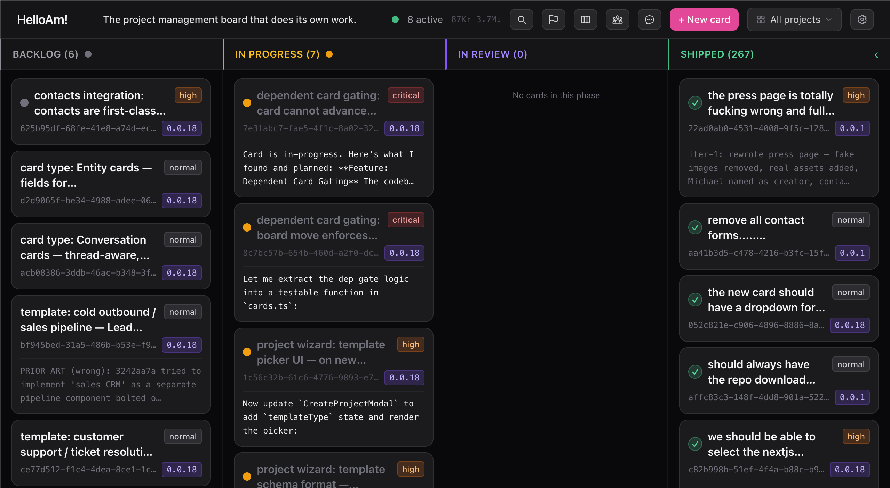

# Michael O'Neal

## Open to US remote senior/staff roles or in office with a relocation bonus

Senior software engineer: production systems and applied AI.
2 decades shipping solid software. Former Co-founder and principal engineer of ClaimHawk (acquired May 2026).
San Diego, CA.

I built ClaimHawk's AI claims-automation platform from the first line of code to five customer pilots, three paying customers and about $10K MRR, before its acquisition in May 2026. I fine-tuned open-weight models, built the computer-vision pipelines around them, and wrapped both in finite-state workflows and guardrails so AI output stays testable and auditable. I also cut per-customer training compute from about $8K to $2K.

> "He's a highly qualified engineer, but what sets him apart is how quickly he learns and understands new domains. Whenever I need an engineer I can count on, I call him first."
> Ryan Bent, Sr. Product Manager, Signet Corp. (worked together 5+ years)

## What I'm building

**[AM](https://github.com/augmentedmike/helloam-agentic-kanban)**: an agentic engineering platform. Tasks move through gated states (backlog, in progress, in review, shipped), and a deterministic gate worker checks criteria and tests before anything advances. Each task runs in its own git worktree with per-iteration commits, so every run has an audit trail. Agents plug in through an adapter interface (Claude, OpenAI-compatible, Gemma).

## Other public work

- [shellmail](https://github.com/augmentedmike/shellmail): keyboard-driven IMAP email client in C, about 3,000 lines
- [whisper-hotkey](https://github.com/augmentedmike/whisper-hotkey): offline speech-to-text on a hotkey, Swift
- [OpenSchedule](https://github.com/augmentedmike/OpenSchedule): self-hosted scheduling, Astro

## Stack

TypeScript, Python, Node, React/Next.js, Rust, C, SQL. PostgreSQL, SQLite, Redis. AWS, Docker, GitHub Actions, Modal. AI in production: Anthropic and OpenAI SDKs, RAG, state-machine workflows, evaluation and guardrails. Also: model fine-tuning and computer vision (PyTorch, OpenCV) where a problem needs it.

## Looking for

Senior/staff software engineering roles on backend, platform or product teams, where I own systems end to end: design, build, ship, operate. I'm strongest on products where correctness matters and AI is one component of a larger system. Remote (US time zones), or in-office with a relocation bonus.

## Contact

augmentedmike@gmail.com | [augmentedmike.com](https://augmentedmike.com) | [LinkedIn](https://www.linkedin.com/in/michael-oneal-9571383b5/)
